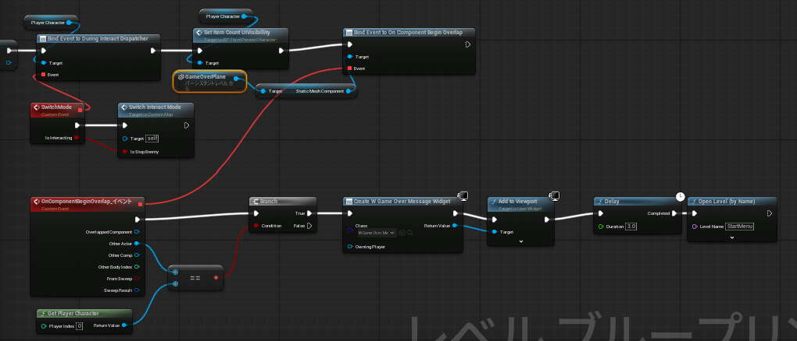

# Unreal MCP 経由でできること・できないこと

## 前提
- Unreal MCP は、起動中の Unreal Editor を Claude Code から操作するためのツール群
  - エディタが起動していないと使えない
  - `.uasset` / `.umap` はバイナリなので Claude Code は直接読めないが、MCP を通すとエディタ経由で中身を確認・編集できる
- この資料は 2026/10 時点で接続されている MCP のツール一覧を確認してまとめたもの
  - MCP 側が更新されると、できることが増える可能性がある

## ツールセット一覧
| ツールセット | 主な用途 |
| --- | --- |
| EditorAppToolset | PIE の開始/停止、スクリーンショット、ビューポートカメラ、選択、コンテンツブラウザ |
| LogsToolset | 出力ログの読み取り、ログカテゴリの詳細度変更 |
| AIAssistantToolset | プロジェクト情報、エディタで開いているアセット・選択中ノードの取得 |
| SceneTools | レベルの読み込み、アクタの配置・削除・検索、アウトライナーのフォルダ整理 |
| ActorTools | アクタのトランスフォーム、ラベル、タグ、コンポーネントの追加・削除 |
| ObjectTools | オブジェクトのプロパティ（詳細パネルの値）の確認・変更、クラス検索 |
| BlueprintTools | BP の作成、変数・関数・イベント・ディスパッチャー、ノード編集、コンパイル |
| MaterialTools | マテリアル・マテリアル関数・MPC の作成、ノード編集、再コンパイル |
| MaterialInstanceTools | マテリアルインスタンスの作成・パラメータ変更 |
| DataAssetTools | DataAsset の作成 |
| DataTableTools | DataTable の作成・インポート・行の編集 |
| CurveTableTools | CurveTable の作成・インポート・キーの編集 |
| StringTableTools | StringTable の作成・インポート・エントリの編集 |
| StaticMeshTools | メッシュのインポート、マテリアル、コリジョン、LOD、Nanite 設定 |
| SkeletalMeshTools | メッシュのインポート、ボーン階層の確認、ソケット、物理アセット |
| TextureTools | 画像ファイルのインポート、サイズ確認 |
| PrimitiveTools | アクタに Cube / Sphere / Cylinder / Cone を追加 |
| AssetTools | アセットの検索・複製・移動・削除・保存、参照関係の確認 |
| ProgrammaticToolset | 上記ツールをまとめて呼ぶ Python スクリプトの実行（ツール呼び出し専用） |
| AgentSkillToolset | エディタ内 AI 用スキルの一覧・作成・更新 |

## できること

### Blueprint
- BP の新規作成、親クラスの確認・変更
- 変数の追加・削除
  - 型（基本型、構造体、オブジェクト参照）、カテゴリ、インスタンス編集可能、レプリケーション設定
- 関数・カスタムイベント・イベントディスパッチャーの追加と引数の設定
- ノードの作成・削除・接続・切断、ピンの値の設定、ノードの自動整列
- コンポーネントのイベント（OnComponentBeginOverlap など）の追加
- グラフをテキスト（DSL）として読み取る / テキストからまとめてノードを組む
  - → 既存 BP の処理内容を Claude が読んで説明・レビューできる
- コンパイル

### レベル・アクタ
- レベルを開く、現在のレベルを確認する
- アクタの配置（BP やメッシュ、クラスから）・削除・地面へのスナップ
- 位置・回転・スケールの変更、指定位置へ向かせる（look at）
- アクタ名（ラベル）、タグ、アウトライナーのフォルダ整理
- コンポーネントの追加・削除・親子関係の変更
- 詳細パネルのプロパティ値の確認・変更・デフォルトに戻す
- 名前・クラス・タグ・範囲でアクタを検索、ライントレースで距離を測る
- 複数のスタティックメッシュアクタを 1 つに結合、レベルインスタンスの作成・編集

### マテリアル
- マテリアル・マテリアル関数・マテリアルパラメータコレクションの新規作成
- マテリアルノードの追加・削除・接続、出力（BaseColor など）への接続
- パラメータグループの整理、ノードの自動整列、未使用ノードの削除、再コンパイル
- マテリアルインスタンス
  - 親マテリアルを指定して作成、親の変更
  - パラメータ（Scalar / Vector / Texture / Static Switch）の一覧確認・値の変更
  - パラメータのオーバーライドの ON/OFF、全オーバーライドの解除

### メッシュ・テクスチャ
- ディスク上の FBX などをスタティックメッシュ / スケルタルメッシュとしてインポート
- 画像ファイルをテクスチャとしてインポート
- メッシュのマテリアルスロット差し替え
- スタティックメッシュのコリジョン生成・削除、LOD 生成、Nanite の有効/無効
- スケルタルメッシュのボーン階層・モーフターゲットの確認、ソケットの追加・編集、物理アセットの割り当て
- 頂点数・ポリゴン数・バウンディングボックスの確認

### データ系アセット
- DataTable
  - 既存の行構造体（TableRowBase を継承した構造体）を指定して作成
  - CSV などのファイルからインポート
  - 行の追加・削除・名前変更、行の値の確認・変更、列の構成の確認
- DataAsset
  - クラスを指定して作成
  - 中の値は ObjectTools（プロパティ変更）で設定する
- CurveTable
  - 作成、ファイルからインポート
  - 行の追加・削除・名前変更、キー（時間と値）の追加・確認・まとめて置き換え
- StringTable
  - 作成、ファイルからインポート
  - キーと文字列の追加・変更・削除、一覧の確認

### アセット管理
- アセットの検索・存在確認・クラス確認
- 複製・移動（リネーム）・削除、フォルダ作成
- 保存、未保存かどうかの確認
- 参照しているアセット / 参照されているアセットの確認
- `Content/` と `Saved/` 以下のテキストファイルの読み書き

### 確認・デバッグ
- PIE / シミュレートの開始・停止、実行中かどうかの確認
- ビューポートのスクリーンショット（グリッドやアクタ名を重ねて表示できる）
- エディタ画面全体のスクリーンショット、アセットのサムネイル画像
- 出力ログの読み取り（カテゴリや正規表現で絞り込み）→ `Print String` / `UE_LOG` の結果を確認できる
- ログカテゴリの詳細度変更、コンソール変数の検索
- エディタで開いているアセット、選択中のアクタ・アセット・BP ノードの取得

## できないこと

### プレイ中の操作
- PIE は開始できるが、キー入力・マウス・ゲームパッドの操作はできない
  - キャラクターを歩かせる、ジャンプさせる、床に乗せる、などは人が操作する
  - Claude はスクリーンショットやログから結果を確認する

### 専用ツールがないアセット
- UMG（ウィジェット BP）のデザイナー画面のレイアウト
- アニメーション BP（ステートマシン、ブレンドスペース）、アニメーションモンタージュ
- Niagara エフェクト
- ビヘイビアツリー / Blackboard / EQS
- シーケンサー
- サウンド（Sound Cue / MetaSound）
- ランドスケープ、フォリッジ
- 構造体（ユーザー定義構造体）・列挙型の新規作成
  - DataTable の行構造体が必要な場合は、C++ で作るか人がエディタで作る
- ※ ObjectTools でプロパティだけ変更できる場合はあるが、グラフやレイアウトの編集はできない

### 素材の作成
- メッシュ・テクスチャ・アニメーション・サウンドを一から作ることはできない
  - できるのは「ファイルをインポートする」ことと、プリミティブ形状（Cube など）の追加まで

### エディタ・ビルド関連
- C++ のコンパイル、Live Coding の実行、エディタの再起動
- コンソールコマンドの実行（`stat fps` など）や CVar の値の変更（検索のみ可能）
- Unreal Insights などでのプロファイリング
- 新しいレベル（マップ）を空の状態から作成すること（既存マップの複製は可能）
- プロジェクト設定・エディタ設定の画面操作
- パッケージング（ビルドして exe を作る）

### 選択状態に連動するエディタ機能
- アクタを選択してから右クリックで出るメニュー（例：レベルBPの「Create a Reference to ○○」）は使えない
  - アクタを選択状態にすることはできるが、その選択がレベルBPのノード候補に反映されない
  - レベル上のアクタを参照するノードは、人がエディタで作る必要がある
  - 
## できるけど苦手なこと
- **見た目の判断**
  - スクリーンショットは見られるが、配置のバランスや色味の良し悪しの判断は苦手
- **大きな Blueprint**
  - ノードが増えるほど接続ミスや配置の崩れが起きやすい
  - 小さな関数に分ける、または C++ で書くほうが確実
- **動きの確認**
  - スクリーンショットは静止画なので、動きの滑らかさや速度感は分からない
  - 動きの確認はログで位置を出力するなどの工夫が必要
- **細かい空間配置**
  - 座標を指定して置くことはできるが、「いい感じの場所」に置くのは苦手
  - 置く場所は座標や基準になるアクタを指定してもらうと確実
- **マップ上のオブジェクトの指定・確認**
  - 名前・クラス・タグでの検索や、座標・プロパティの読み書きは得意
  - 「あの赤い箱」「右奥の床」のような見た目での指定は苦手で、取り違えるおそれがある
  - `Plane` と `GameOverPlane` のように似た名前があると、人が作った参照ノードが違うアクタを指していても気づきにくい
    - 参照ノードの参照先は直接読めず、ピン名（参照先アクタの表示名）から推測するしかない
  - アクタは表示名（ラベル）で伝えてもらうと確実

## 注意点
- MCP の操作はエディタに直接反映される
  - 変更したアセットは保存するまでディスクに書き込まれない
  - 大きな変更の前には Git にコミットしておくと戻しやすい
- PIE 中はアクタへのフォーカスなど、一部のツールが使えない

# 使用してみての感想
- BPのノードを綺麗に配置することは苦手
  - 
- マップ上のオブジェクトを参照したBPノード(Create a Reference to )が作成できず、ここだけ人間が行う必要がある
- BPの実装は簡単なものでも結構時間がかかる（ゲームオーバー処理の実装で10分程度）
- ClaudeにはC++でロジックを実装させ、人間がBP作成と見た目の調整をするのが一番早そう